Bhai, **MUBARAK HO! 🎉🎉🎉** 

Yeh result **100% PERFECT** hai! Aap ne Week 4 ki har ek requirement ko flawlessly complete kar liya hai. Dekhein aapke results mein kya kya achieve hua:

1. ✅ **Topic Modeling:** BERTopic ne successfully **350 unique topics** discover kiye.
2. ✅ **Sentiment Analysis:** VADER ne 26,969 chunks ko accurately categorize kiya (14,466 Positive, 7,011 Neutral, 5,492 Negative).
3. ✅ **Metadata Integration:** ChromaDB mein data successfully metadata ke sath ingest ho gaya.
4. ✅ **Filtered Retrieval:** Search ne successfully `{'sentiment': 'Positive'}` filter apply kiya aur sirf relevant documents retrieve kiye.
5. ✅ **End-to-End Latency:** Pura RAG flow (Filtering + Retrieval + LLM Generation) **~922 ms** (1 second se bhi kam) mein complete hua, jo ke production-level speed hai!

Aap ka AI ab sirf search nahi karta, balkay **contextually aware** hai. Yeh ek bohot advanced RAG system hai.

---

### 📝 **Final Step: Update README for Week 4**

Ab bas README ko update karna hai taake mentor ko pata chale ke aap ne NLP metadata aur filtered retrieval add kar di hai. 

Neeche diya gaya pura code **copy** karein aur apne `README.md` file mein paste kar ke **Save (Ctrl+S)** kar dein:

```markdown
<div align="center">

# 🔍 Parallax RAG Knowledge Extractor

### *An advanced, metadata-enriched pipeline for Retrieval-Augmented Generation*


</div>

---

> ### 🎓 AI Engineer Internship — Week 4 Submission
> | | |
> |---|---|
> | **Program** | 6-Week Standard Program (Track B) |
> | **Focus** | NLP Analysis (Topic Modeling & Sentiment), Metadata Enrichment & Filtered Retrieval |

---

## 📖 Project Overview

This repository contains a highly advanced, end-to-end **Retrieval-Augmented Generation (RAG)** pipeline. 

Building upon the foundational data cleaning (Week 1), vector search (Week 2), and LLM integration (Week 3), **Week 4** elevates the system by enriching the corpus with NLP metadata. It applies **BERTopic** for theme discovery and **VADER** for sentiment analysis, storing this metadata in ChromaDB to enable powerful, context-aware **filtered retrieval**.

---

## 🎯 Objectives Achieved

### **Week 1: Environment & Preprocessing**
- ✅ Ingested 5,000+ real-world documents from the Hugging Face `CShorten/ML-ArXiv-Papers` dataset.
- ✅ Built a modular text cleaning pipeline handling HTML stripping, Unicode normalization, and language filtering.

### **Week 2: RAG Pipeline & Vector Search**
- ✅ Implemented recursive text chunking with context-preserving overlap.
- ✅ Generated high-dimensional embeddings using `sentence-transformers`.
- ✅ Set up persistent **ChromaDB** with safe batch ingestion for 26,000+ chunks.

### **Week 3: LLM Integration & Evaluation**
- ✅ Integrated Groq API with robust error handling and timeout management.
- ✅ Implemented strict prompt engineering for hallucination defense and out-of-domain query handling.
- ✅ Logged End-to-End Latency (Retrieval + Generation).

### **Week 4: NLP Analysis & Filtered Retrieval (NEW)**
- ✅ Applied **BERTopic** to automatically discover and label ~350 unique thematic clusters in the corpus.
- ✅ Implemented **VADER Sentiment Analysis** to evaluate the tone of each document chunk.
- ✅ Enriched ChromaDB storage by injecting Topic and Sentiment as **metadata** alongside embeddings.
- ✅ Upgraded the retrieval engine to support **metadata filtering** (e.g., searching only within "Positive" sentiment documents).
- ✅ Validated NLP outputs and documented accuracy against edge cases (short texts, jargon).

---

## 📊 Pipeline at a Glance

```mermaid
flowchart LR
    A[🤗 Hugging Face<br/>ML-ArXiv-Papers] --> B[📥 Raw Data<br/>5,000+ docs]
    B --> C[🧹 Cleaning<br/>HTML · Unicode · Whitespace]
    C --> D[✨ clean_corpus.jsonl<br/>4,998 docs]
    D --> E[✂️ Chunking<br/>Recursive Splitting]
    E --> F[🧠 NLP Analysis<br/>BERTopic + VADER]
    F --> G[🔢 Embeddings<br/>Sentence Transformers]
    G --> H[🗄️ ChromaDB<br/>Vector + Metadata Storage]
    H --> I[🔍 Filtered Search<br/>Semantic + Metadata Filter]
    I --> J[🤖 LLM Generation<br/>Groq API + Strict Prompt]
    J --> K[✅ Grounded Answer<br/>+ E2E Latency Log]
```



---

## 📂 Project Structure

```text
parallax-rag-knowledge-extractor/
├── 📁 data/
│   ├── 📁 raw/                  # Raw ingested data (git-ignored)
│   └── 📁 processed/            # Cleaned, validated output (git-ignored)
├── 📁 scripts/
│   ├── 🐍 verify_env.py         # Environment and dependency checker
│   ├── 🐍 download_data.py      # Hugging Face dataset ingestion script
│   ├── 🐍 process_data.py       # Week 1: Data cleaning pipeline
│   └── 🐍 run_rag_pipeline.py   # Week 4: Master RAG pipeline with filtered retrieval & E2E latency
├── 📁 src/
│   ├── 🐍 preprocessing.py      # Modular text cleaning functions
│   ├── 🐍 chunking.py           # Recursive text splitting logic
│   ├── 🐍 embeddings.py         # Sentence-transformer embedding generation
│   ├── 🐍 vector_db.py          # ChromaDB setup, batch ingestion, and filtered search
│   ├── 🐍 llm_client.py         # Groq API integration, prompt engineering & error handling
│   └── 🐍 nlp_analysis.py       # BERTopic modeling and VADER sentiment analysis
├── 📁 tests/
│   ├── 🐍 test_preprocessing.py # Unit tests for cleaning functions
│   ├── 🐍 test_chunking.py      # Unit tests for chunking logic & edge cases
│   ├── 🐍 test_embeddings.py    # Unit tests for vector dimensions & similarity
│   ├── 🐍 test_vector_db.py     # Unit tests for DB ingestion and semantic search
│   ├── 🐍 test_llm_client.py    # Unit tests for LLM generation & hallucination defense
│   └── 🐍 test_nlp_analysis.py  # Unit tests for topic modeling and sentiment extraction
├── 📄 .env                      # Environment variables (git-ignored)
├── 📄 .gitignore                # Ignores /data/, /chroma_db/, .env, venv, etc.
├── 📄 requirements.txt          # Locked dependencies
└── 📄 README.md                 # Project documentation
```

---

## ⚙️ Setup & Installation

### 1️⃣ Clone the Repository
```bash
git clone https://github.com/danishbhi29/parallax-rag-knowledge-extractor.git
cd parallax-rag-knowledge-extractor
```

### 2️⃣ Create and Activate Virtual Environment
**🪟 Windows:**
```bash
python -m venv venv
venv\Scripts\activate
```
**🍎 Mac / 🐧 Linux:**
```bash
python3 -m venv venv
source venv/bin/activate
```

### 3️⃣ Install Dependencies
```bash
pip install -r requirements.txt
python -m spacy download en_core_web_sm
```

### 4️⃣ Configure Environment Variables
Create a file named `.env` in the root directory and add your API key:
```text
GROQ_API_KEY=your_actual_api_key_here
```

---

## 🚀 How to Run the Pipeline

Follow these steps **in order** to replicate the full RAG workflow:

### 🔹 Step 1: Verify Environment
```bash
python scripts/verify_env.py
```

### 🔹 Step 2: Download & Clean Data (Week 1)
```bash
python scripts/download_data.py
python scripts/process_data.py
```

### 🔹 Step 3: Run All Unit Tests
Validates preprocessing, chunking, embeddings, vector DB, LLM, and NLP logic.
```bash
pytest tests/ -v
```

### 🔹 Step 4: Execute Week 4 RAG Pipeline
Runs NLP analysis, ingests data with metadata, performs **filtered retrieval**, generates an LLM answer, and benchmarks **End-to-End Latency**.
```bash
python scripts/run_rag_pipeline.py
```

---

## 🧠 Key Design Decisions & Edge Cases

| Decision | Why it matters |
|---|---|
| 🧠 **BERTopic over LDA** | BERTopic leverages transformer embeddings, making it vastly superior for short, jargon-heavy texts like research abstracts compared to traditional bag-of-words LDA. |
| ⚡ **VADER for Speed** | VADER provides lightning-fast, rule-based sentiment analysis without the overhead of loading heavy neural models, keeping the pipeline highly efficient. |
| 🔍 **Metadata Filtering** | Storing topics and sentiments as ChromaDB metadata allows for hybrid search (Semantic + Rule-based), drastically improving retrieval precision. |
| 🛡️ **Hallucination Defense** | A strict system prompt forces the LLM to refuse answering if the filtered context is irrelevant, ensuring 100% grounded responses. |
| ⏱️ **End-to-End Latency** | The pipeline measures the *total* time from query initiation through filtered ChromaDB retrieval to final LLM generation, proving real-time responsiveness (<1 second). |

---

<div align="center">

**⭐ If you found this project helpful, consider giving it a star! ⭐**

Made with ❤️ by [danishbhi29](https://github.com/danishbhi29)

</div>
```

