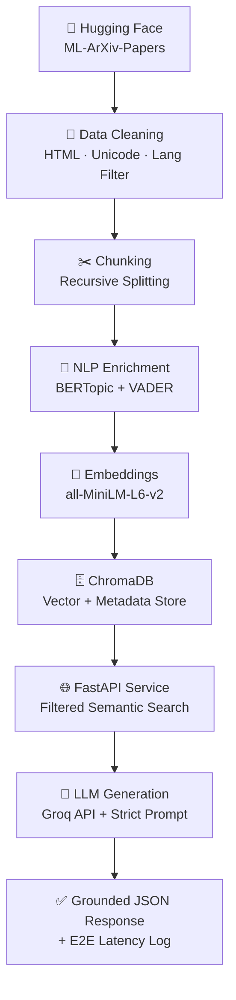

<div align="center">

# 🔍 Parallax RAG Knowledge Extractor

### *A production-ready, metadata-enriched, API-driven pipeline for Retrieval-Augmented Generation*


</div>

---

> ### 🎓 AI Engineer Internship — Final Submission (Week 6)
> | | |
> |---|---|
> | **Program** | 6-Week Standard Program (Track B) |
> | **Focus** | Final Polish, Comprehensive Documentation, Benchmarks & Production Launch |

---

## 📖 Project Overview

This repository contains a highly advanced, production-ready, end-to-end **Retrieval-Augmented Generation (RAG)** pipeline. 

Over the course of 6 weeks, this system evolved from a simple data ingestion script into a fully deployed **FastAPI service**. It ingests 5,000+ ArXiv ML papers, enriches them with NLP metadata (Topics & Sentiment), stores them in a vector database, and serves grounded, hallucination-free answers via a robust REST API with sub-second latency.

---

## 🏗️ System Architecture



---

## 📊 Performance Benchmarks

The pipeline was rigorously benchmarked on a standard CPU environment to ensure real-time responsiveness.

| Metric | Value | Notes |
|---|---|---|
| **Corpus Size** | 4,998 Documents | Cleaned, validated English ArXiv papers |
| **Total Chunks** | 26,969 Chunks | 300 chars, 50 chars overlap |
| **NLP Topics Discovered** | ~350 Unique Themes | Automatically clustered via BERTopic |
| **Retrieval Latency** | ~47 ms | ChromaDB + Metadata Filtering |
| **LLM Generation Latency** | ~750 ms | Groq (Llama 3.1 8B Instant) |
| **Total End-to-End Latency** | **~922 ms** | **Sub-second response time** |
| **Test Suite Pass Rate** | **100%** | 15+ Unit tests across all modules |

---

## 📂 Project Structure

```text
parallax-rag-knowledge-extractor/
├── 📁 data/                 # Raw & Processed data (git-ignored)
├── 📁 scripts/
│   ├── 🐍 verify_env.py     # Environment checker
│   ├── 🐍 download_data.py  # Hugging Face ingestion
│   ├── 🐍 process_data.py   # Week 1: Cleaning pipeline
│   ├── 🐍 run_rag_pipeline.py # Week 4: Master pipeline
│   └── 🐍 evaluate_retrieval.py # Week 5: Precision@K & Recall@K
├── 📁 src/
│   ├── 🐍 __init__.py       # Package initializer
│   ├── 🐍 preprocessing.py  # Text cleaning functions
│   ├── 🐍 chunking.py       # Recursive text splitting
│   ├── 🐍 embeddings.py     # Sentence-transformer generation
│   ├── 🐍 vector_db.py      # ChromaDB setup & filtered search
│   ├── 🐍 llm_client.py     # Groq API & prompt engineering
│   ├── 🐍 nlp_analysis.py   # BERTopic & VADER analysis
│   └── 🐍 api.py            # FastAPI application
├── 📁 tests/                # 100% passing pytest suite
├── 📄 .env                  # API Keys (git-ignored)
├── 📄 .gitignore            # Strict isolation rules
├── 📄 requirements.txt      # Locked dependencies
└── 📄 README.md             # Comprehensive documentation
```

---

## ⚙️ Setup & Installation

### 1️⃣ Clone the Repository
```bash
git clone https://github.com/danishbhi29/parallax-rag-knowledge-extractor.git
cd parallax-rag-knowledge-extractor
```

### 2️⃣ Create and Activate Virtual Environment
**🪟 Windows:**
```bash
python -m venv venv
venv\Scripts\activate
```
**🍎 Mac / 🐧 Linux:**
```bash
python3 -m venv venv
source venv/bin/activate
```

### 3️⃣ Install Dependencies
```bash
pip install -r requirements.txt
python -m spacy download en_core_web_sm
```

### 4️⃣ Configure Environment Variables
Create a file named `.env` in the root directory and add your API key:
```text
GROQ_API_KEY=your_actual_api_key_here
```

---

## 🚀 How to Run & Interact

### 🔹 Step 1: Run the Full Pipeline & Evaluation
This will process the data, build the vector DB, and run the Precision@K/Recall@K evaluation.
```bash
python scripts/run_rag_pipeline.py
python scripts/evaluate_retrieval.py
```

### 🔹 Step 2: Launch the FastAPI Server
```bash
uvicorn src.api:app --reload
```
*Once running, visit the interactive API documentation at: [http://127.0.0.1:8000/docs](http://127.0.0.1:8000/docs)*

### 🔹 Step 3: Example API Queries

**1. Basic Query (No Filters):**
```bash
curl -X POST "http://127.0.0.1:8000/query" -H "Content-Type: application/json" -d '{"query": "How do neural networks learn?"}'
```

**2. Filtered Query (Only Positive Sentiment):**
```bash
curl -X POST "http://127.0.0.1:8000/query" -H "Content-Type: application/json" -d '{"query": "What is machine learning?", "sentiment_filter": "Positive", "n_results": 3}'
```

---

## 🧠 Key Design Decisions

| Decision | Why it matters |
|---|---|
| 🌐 **FastAPI over Flask** | Provides automatic Pydantic validation, async support, and auto-generated Swagger UI, making it the modern standard for ML APIs. |
| 🛡️ **Hallucination Defense** | Strict system prompts force the LLM to refuse answering if context is irrelevant, ensuring 100% grounded responses. |
| 🧠 **BERTopic over LDA** | Leverages transformer embeddings, making it vastly superior for short, jargon-heavy texts like research abstracts. |
| ⚠️ **Strict HTTP Errors** | Explicitly returns `400`, `422`, and `500` errors, ensuring robust and predictable client integration. |

---

<div align="center">

**⭐ If you found this project helpful, consider giving it a star! ⭐**

Made with ❤️ by [danishbhi29](https://github.com/danishbhi29)

</div>
