<div align="center">

# 🔍 Parallax RAG Knowledge Extractor

**A metadata-enriched Retrieval-Augmented Generation pipeline with topic modeling, sentiment analysis, and filtered semantic search.**

[](https://www.python.org/)
[](https://huggingface.co/datasets/CShorten/ML-ArXiv-Papers)
[](https://www.trychroma.com/)
[](https://groq.com/)
[](https://docs.pytest.org/)
[](#-roadmap)

[Overview](#-overview) •
[Features](#-features) •
[Architecture](#-architecture) •
[Quick Start](#-quick-start) •
[Design Decisions](#-design-decisions) •
[Roadmap](#-roadmap)

</div>

---

## 🎓 Internship Context

| | |
|:--|:--|
| **Program** | AI Engineer Internship — 6-Week Standard Program (Track B) |
| **Current Milestone** | Week 4 — NLP Analysis, Metadata Enrichment & Filtered Retrieval |
| **Dataset** | [`CShorten/ML-ArXiv-Papers`](https://huggingface.co/datasets/CShorten/ML-ArXiv-Papers) (Hugging Face) |

---

## 📖 Overview

**Parallax RAG Knowledge Extractor** is an end-to-end RAG system built on thousands of machine-learning research abstracts from arXiv. It cleans raw text, splits it into chunks, embeds it, stores it in a vector database, and answers questions with an LLM grounded strictly in the retrieved context.

Week 4 adds an **NLP enrichment layer**: every chunk is tagged with a **BERTopic** theme and a **VADER** sentiment label, both stored as ChromaDB **metadata**. This enables **hybrid retrieval**, combining semantic similarity with rule-based metadata filters, so queries can be scoped to a specific topic or tone.

---

## ✨ Features

| Capability | Details |
|:--|:--|
| 🧹 **Robust preprocessing** | HTML stripping, Unicode normalization, whitespace cleanup, and language filtering. |
| ✂️ **Smart chunking** | Recursive splitting with overlap to preserve context across chunk boundaries. |
| 🔢 **Semantic embeddings** | Dense vectors generated with `sentence-transformers`. |
| 🗄️ **Persistent vector store** | ChromaDB with safe batch ingestion for **26,000+ chunks**. |
| 🧠 **Topic discovery** | BERTopic automatically discovers and labels **~350 thematic clusters**. |
| 💬 **Sentiment tagging** | VADER scores the tone of every chunk (fast and rule-based). |
| 🔍 **Filtered retrieval** | Combine semantic search with metadata filters (e.g. only *Positive* chunks). |
| 🤖 **Grounded generation** | Groq-hosted LLM with a strict prompt, timeout handling, and out-of-domain refusal. |
| ⏱️ **Latency logging** | Measures end-to-end time: retrieval + generation. |
| ✅ **Unit-tested** | Dedicated `pytest` suites for every module. |

---

## 🏗️ Architecture

```mermaid
flowchart LR
    subgraph Ingest["📥 Ingestion & Cleaning"]
        A[🤗 Hugging Face<br/>ML-ArXiv-Papers] --> B[Raw Data<br/>5,000+ docs]
        B --> C[🧹 Cleaning<br/>HTML · Unicode · Whitespace]
        C --> D[clean_corpus.jsonl<br/>4,998 docs]
    end

    subgraph Enrich["🧠 Processing & Enrichment"]
        D --> E[✂️ Recursive Chunking]
        E --> F[BERTopic + VADER<br/>Topic & Sentiment]
        F --> G[🔢 Sentence-Transformer<br/>Embeddings]
    end

    subgraph Serve["🔍 Retrieval & Generation"]
        G --> H[(🗄️ ChromaDB<br/>Vectors + Metadata)]
        H --> I[Filtered Semantic Search]
        I --> J[🤖 Groq LLM<br/>Strict Prompt]
        J --> K[✅ Grounded Answer<br/>+ Latency Log]
    end
```



### Evolution by Week

<details open>
<summary><b>Week 1 — Environment & Preprocessing</b></summary>

- Ingested 5,000+ real-world documents from `CShorten/ML-ArXiv-Papers`.
- Built a modular cleaning pipeline (HTML stripping, Unicode normalization, language filtering), producing **4,998** clean documents.

</details>

<details open>
<summary><b>Week 2 — RAG Pipeline & Vector Search</b></summary>

- Implemented recursive chunking with context-preserving overlap.
- Generated embeddings with `sentence-transformers`.
- Set up persistent ChromaDB with safe batch ingestion for 26,000+ chunks.

</details>

<details open>
<summary><b>Week 3 — LLM Integration & Evaluation</b></summary>

- Integrated the Groq API with robust error handling and timeout management.
- Engineered a strict prompt for hallucination defense and out-of-domain query handling.
- Logged end-to-end latency (retrieval + generation).

</details>

<details open>
<summary><b>Week 4 — NLP Analysis & Filtered Retrieval ✨ NEW</b></summary>

- Applied **BERTopic** to discover and label ~350 thematic clusters.
- Applied **VADER** sentiment analysis to every chunk.
- Stored topic and sentiment as **ChromaDB metadata** alongside embeddings.
- Upgraded retrieval to support **metadata filtering**.
- Validated NLP outputs and documented behavior on edge cases (short texts, technical jargon).

</details>

---

## 📂 Project Structure

```text
parallax-rag-knowledge-extractor/
├── data/
│   ├── raw/                     # Raw ingested data (git-ignored)
│   └── processed/               # Cleaned, validated output (git-ignored)
├── scripts/
│   ├── verify_env.py            # Environment & dependency checker
│   ├── download_data.py         # Hugging Face dataset ingestion
│   ├── process_data.py          # Week 1: data cleaning pipeline
│   └── run_rag_pipeline.py      # Master pipeline: NLP, filtered retrieval, LLM, latency
├── src/
│   ├── preprocessing.py         # Modular text-cleaning functions
│   ├── chunking.py              # Recursive text splitting
│   ├── embeddings.py            # Sentence-transformer embedding generation
│   ├── vector_db.py             # ChromaDB setup, batch ingestion, filtered search
│   ├── llm_client.py            # Groq integration, prompt engineering, error handling
│   └── nlp_analysis.py          # BERTopic modeling & VADER sentiment
├── tests/
│   ├── test_preprocessing.py    # Cleaning functions
│   ├── test_chunking.py         # Chunking logic & edge cases
│   ├── test_embeddings.py       # Vector dimensions & similarity
│   ├── test_vector_db.py        # DB ingestion & semantic search
│   ├── test_llm_client.py       # LLM generation & hallucination defense
│   └── test_nlp_analysis.py     # Topic modeling & sentiment extraction
├── .env                         # Environment variables (git-ignored)
├── .gitignore                   # Ignores data/, chroma_db/, .env, venv, etc.
├── requirements.txt             # Pinned dependencies
└── README.md
```

---

## 🛠️ Tech Stack

| Layer | Technology |
|:--|:--|
| Language | Python 3.10+ |
| Data | Hugging Face `datasets` |
| Embeddings | `sentence-transformers` |
| Vector DB | ChromaDB |
| Topic Modeling | BERTopic |
| Sentiment | VADER |
| LLM Inference | Groq API |
| Testing | pytest |

---

## 🚀 Quick Start

### Prerequisites

- Python **3.10+**
- A [Groq API key](https://console.groq.com/)

### 1. Clone the repository

```bash
git clone https://github.com/danishbhi29/parallax-rag-knowledge-extractor.git
cd parallax-rag-knowledge-extractor
```

### 2. Create and activate a virtual environment

<table>
<tr>
<td><b>🪟 Windows</b></td>
<td><b>🍎 macOS / 🐧 Linux</b></td>
</tr>
<tr>
<td>

```bash
python -m venv venv
venv\Scripts\activate
```

</td>
<td>

```bash
python3 -m venv venv
source venv/bin/activate
```

</td>
</tr>
</table>

### 3. Install dependencies

```bash
pip install -r requirements.txt
python -m spacy download en_core_web_sm
```

### 4. Configure environment variables

Create a `.env` file in the project root:

```env
GROQ_API_KEY=your_actual_api_key_here
```

> ⚠️ Never commit your `.env` file. It is already listed in `.gitignore`.

---

## ▶️ Running the Pipeline

Run these steps **in order**:

| Step | Command | What it does |
|:--:|:--|:--|
| **1** | `python scripts/verify_env.py` | Verifies the environment and dependencies. |
| **2** | `python scripts/download_data.py` | Downloads the dataset from Hugging Face. |
| **3** | `python scripts/process_data.py` | Cleans the data and writes `clean_corpus.jsonl`. |
| **4** | `pytest tests/ -v` | Runs all unit tests (preprocessing, chunking, embeddings, vector DB, LLM, NLP). |
| **5** | `python scripts/run_rag_pipeline.py` | Runs NLP analysis, ingests data with metadata, performs filtered retrieval, generates an LLM answer, and benchmarks latency. |

---

## 🔎 How Filtered Retrieval Works

Each chunk is stored in ChromaDB with its embedding **and** its NLP metadata. At query time, ChromaDB applies the metadata filter first and ranks the remaining chunks by semantic similarity.

```python
# Illustrative example: field names may differ in vector_db.py
results = collection.query(
    query_texts=["How do transformers handle long sequences?"],
    n_results=5,
    where={"sentiment": "Positive"},   # metadata filter
)
```

This lets you scope retrieval to, for example, a specific BERTopic theme or only chunks with a given sentiment label.

---

## 🧠 Design Decisions

| Decision | Rationale |
|:--|:--|
| **BERTopic over LDA** | BERTopic uses transformer embeddings, which typically handle short, jargon-heavy text such as research abstracts better than bag-of-words LDA. |
| **VADER for sentiment** | Rule-based and very fast, with no heavy neural model to load, which keeps the pipeline lightweight. |
| **Metadata filtering** | Storing topic and sentiment alongside embeddings enables hybrid search (semantic + rule-based) and can improve retrieval precision. |
| **Hallucination defense** | A strict system prompt instructs the LLM to decline when the retrieved context is irrelevant, keeping answers grounded in the corpus. |
| **End-to-end latency** | Timing covers the full path (filtered retrieval through LLM generation) to reflect real user-perceived responsiveness. |

---

## ⚠️ Known Limitations

- **VADER on technical text:** VADER was designed for social-media-style language, so sentiment on neutral, formal scientific abstracts can be noisy; very short chunks are especially unreliable.
- **Topic quality:** Some BERTopic clusters may be overly granular or overlap, and outlier chunks may be left unassigned.
- **Latency:** Total latency depends on network conditions and Groq API load, so results will vary between runs.
- **Prompt-based grounding:** Hallucination defense relies on prompting, which strongly reduces but cannot fully guarantee grounded answers.

---

## 🗺️ Roadmap

- [x] **Week 1:** Environment setup & data preprocessing
- [x] **Week 2:** Chunking, embeddings & vector search
- [x] **Week 3:** LLM integration & evaluation
- [x] **Week 4:** Topic modeling, sentiment analysis & filtered retrieval
- [ ] **Week 5:** *Coming soon*
- [ ] **Week 6:** *Coming soon*

---

<div align="center">

**⭐ If you found this project helpful, consider giving it a star! ⭐**

Made with ❤️ by [danishbhi29](https://github.com/danishbhi29)

</div>
