<div align="center">

# 🔍 Parallax RAG Knowledge Extractor

### *An advanced, metadata-enriched, API-ready pipeline for Retrieval-Augmented Generation*


</div>

---

> ### 🎓 AI Engineer Internship — Week 5 Submission
> | | |
> |---|---|
> | **Program** | 6-Week Standard Program (Track B) |
> | **Focus** | FastAPI Integration, Retrieval Evaluation (Precision@K/Recall@K), and Automated Testing |

---

## 📖 Project Overview

This repository contains a highly advanced, production-ready, end-to-end **Retrieval-Augmented Generation (RAG)** pipeline. 

Building upon the foundational data cleaning (Week 1), vector search (Week 2), LLM integration (Week 3), and NLP metadata enrichment (Week 4), **Week 5** elevates the system by wrapping it in a robust **FastAPI** service. It includes structured request logging, proper HTTP error handling, automated retrieval evaluation metrics, and comprehensive unit testing.

---

## 🎯 Objectives Achieved

### **Week 1: Environment & Preprocessing**
- ✅ Ingested 5,000+ real-world documents from the Hugging Face `CShorten/ML-ArXiv-Papers` dataset.
- ✅ Built a modular text cleaning pipeline handling HTML stripping, Unicode normalization, and language filtering.

### **Week 2: RAG Pipeline & Vector Search**
- ✅ Implemented recursive text chunking with context-preserving overlap.
- ✅ Generated high-dimensional embeddings using `sentence-transformers`.
- ✅ Set up persistent **ChromaDB** with safe batch ingestion for 26,000+ chunks.

### **Week 3: LLM Integration & Evaluation**
- ✅ Integrated Groq API with robust error handling and timeout management.
- ✅ Implemented strict prompt engineering for hallucination defense and out-of-domain query handling.
- ✅ Logged End-to-End Latency (Retrieval + Generation).

### **Week 4: NLP Analysis & Filtered Retrieval**
- ✅ Applied **BERTopic** to automatically discover and label ~350 unique thematic clusters.
- ✅ Implemented **VADER Sentiment Analysis** to evaluate the tone of each document chunk.
- ✅ Enriched ChromaDB storage by injecting Topic and Sentiment as metadata alongside embeddings.
- ✅ Upgraded the retrieval engine to support metadata filtering.

### **Week 5: FastAPI Service & Automated Evaluation (NEW)**
- ✅ Wrapped the entire RAG system in a **FastAPI** application with proper endpoints (`/health`, `/query`).
- ✅ Implemented structured request logging and proper HTTP error responses (400 Bad Request, 422 Unprocessable Entity, 500 Internal Server Error).
- ✅ Wrote a retrieval evaluation script calculating **Precision@K** and **Recall@K** on a test set.
- ✅ Wrote comprehensive **unit tests for FastAPI endpoints** using `pytest` and `TestClient`, achieving 100% pass rate.

---

## 📊 Pipeline at a Glance

```mermaid
flowchart LR
    A[🤗 Hugging Face<br/>ML-ArXiv-Papers] --> B[📥 Raw Data<br/>5,000+ docs]
    B --> C[🧹 Cleaning<br/>HTML · Unicode · Whitespace]
    C --> D[✨ clean_corpus.jsonl<br/>4,998 docs]
    D --> E[✂️ Chunking<br/>Recursive Splitting]
    E --> F[🧠 NLP Analysis<br/>BERTopic + VADER]
    F --> G[🔢 Embeddings<br/>Sentence Transformers]
    G --> H[🗄️ ChromaDB<br/>Vector + Metadata Storage]
    H --> I[🌐 FastAPI Service<br/>Filtered Search + Error Handling]
    I --> J[🤖 LLM Generation<br/>Groq API + Strict Prompt]
    J --> K[✅ Grounded Answer<br/>+ E2E Latency Log]
```



---

## 📂 Project Structure

```text
parallax-rag-knowledge-extractor/
├── 📁 data/
│   ├── 📁 raw/                  # Raw ingested data (git-ignored)
│   └── 📁 processed/            # Cleaned, validated output (git-ignored)
├── 📁 scripts/
│   ├── 🐍 verify_env.py         # Environment and dependency checker
│   ├── 🐍 download_data.py      # Hugging Face dataset ingestion script
│   ├── 🐍 process_data.py       # Week 1: Data cleaning pipeline
│   ├── 🐍 run_rag_pipeline.py   # Week 4: Master RAG pipeline with filtered retrieval
│   └── 🐍 evaluate_retrieval.py # Week 5: Precision@K and Recall@K evaluation script
├── 📁 src/
│   ├── 🐍 __init__.py           # Initializes src as a Python package
│   ├── 🐍 preprocessing.py      # Modular text cleaning functions
│   ├── 🐍 chunking.py           # Recursive text splitting logic
│   ├── 🐍 embeddings.py         # Sentence-transformer embedding generation
│   ├── 🐍 vector_db.py          # ChromaDB setup, batch ingestion, and filtered search
│   ├── 🐍 llm_client.py         # Groq API integration, prompt engineering & error handling
│   ├── 🐍 nlp_analysis.py       # BERTopic modeling and VADER sentiment analysis
│   └── 🐍 api.py                # FastAPI application with structured logging and error handling
├── 📁 tests/
│   ├── 🐍 test_preprocessing.py # Unit tests for cleaning functions
│   ├── 🐍 test_chunking.py      # Unit tests for chunking logic & edge cases
│   ├── 🐍 test_embeddings.py    # Unit tests for vector dimensions & similarity
│   ├── 🐍 test_vector_db.py     # Unit tests for DB ingestion and semantic search
│   ├── 🐍 test_llm_client.py    # Unit tests for LLM generation & hallucination defense
│   ├── 🐍 test_nlp_analysis.py  # Unit tests for topic modeling and sentiment extraction
│   └── 🐍 test_api.py           # Unit tests for FastAPI endpoints (health, query, errors)
├── 📄 .env                      # Environment variables (git-ignored)
├── 📄 .gitignore                # Ignores /data/, /chroma_db/, .env, venv, etc.
├── 📄 requirements.txt          # Locked dependencies
└── 📄 README.md                 # Project documentation
```

---

## ⚙️ Setup & Installation

### 1️⃣ Clone the Repository
```bash
git clone https://github.com/danishbhi29/parallax-rag-knowledge-extractor.git
cd parallax-rag-knowledge-extractor
```

### 2️⃣ Create and Activate Virtual Environment
**🪟 Windows:**
```bash
python -m venv venv
venv\Scripts\activate
```
**🍎 Mac / 🐧 Linux:**
```bash
python3 -m venv venv
source venv/bin/activate
```

### 3️⃣ Install Dependencies
```bash
pip install -r requirements.txt
python -m spacy download en_core_web_sm
```

### 4️⃣ Configure Environment Variables
Create a file named `.env` in the root directory and add your API key:
```text
GROQ_API_KEY=your_actual_api_key_here
```

---

## 🚀 How to Run the System

Follow these steps **in order** to replicate the full workflow:

### 🔹 Step 1: Verify Environment & Clean Data (Week 1)
```bash
python scripts/verify_env.py
python scripts/download_data.py
python scripts/process_data.py
```

### 🔹 Step 2: Run All Unit Tests
Validates preprocessing, chunking, embeddings, vector DB, LLM, NLP, and FastAPI logic.
```bash
pytest tests/ -v
```

### 🔹 Step 3: Run Retrieval Evaluation (Week 5)
Calculates and logs Precision@K and Recall@K metrics.
```bash
python scripts/evaluate_retrieval.py
```

### 🔹 Step 4: Start the FastAPI Server (Week 5)
Launches the production-ready API server.
```bash
uvicorn src.api:app --reload
```
*(Once running, visit http://127.0.0.1:8000/docs to interact with the live API documentation).*

---

## 🧠 Key Design Decisions & Edge Cases

| Decision | Why it matters |
|---|---|
| 🌐 **FastAPI over Flask** | FastAPI provides automatic data validation (via Pydantic), async support, and auto-generated Swagger UI docs, making it the modern standard for ML APIs. |
| ⚠️ **Strict HTTP Error Handling** | The API explicitly returns `400` for bad filters, `422` for invalid payload shapes, and `500` for unexpected server crashes, ensuring robust client integration. |
| 📏 **Precision@K & Recall@K** | Evaluating retrieval quality with standard IR metrics proves the vector database is actually fetching relevant context, not just random chunks. |
| 🧠 **BERTopic over LDA** | BERTopic leverages transformer embeddings, making it vastly superior for short, jargon-heavy texts like research abstracts compared to traditional bag-of-words LDA. |
| 🔒 **Secure API Management** | API keys are strictly managed via `.env` files and excluded from version control to prevent security breaches. |

---

<div align="center">

**⭐ If you found this project helpful, consider giving it a star! ⭐**

Made with ❤️ by [danishbhi29](https://github.com/danishbhi29)

</div>
